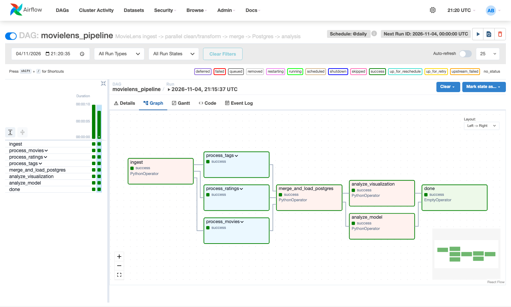
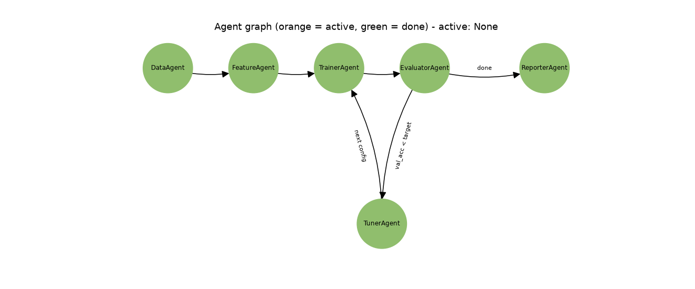
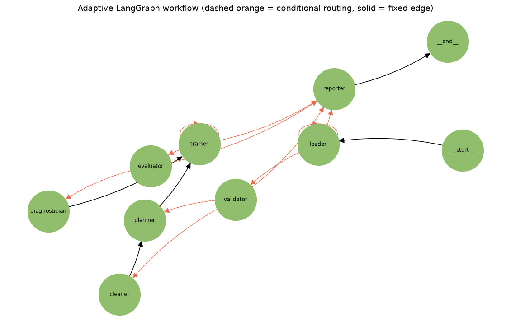
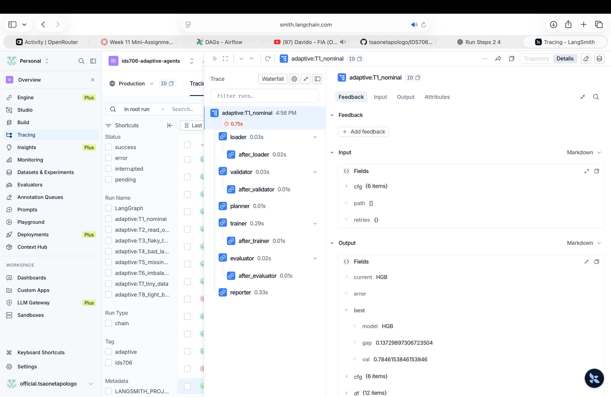

# IDS706 Week 11 – Orchestration, Agent Workflows and an Adaptive Multi-Agent System

I built an end-to-end data pipeline in Airflow, trained models on its output with an agent-based loop, and then (bonus) built an adaptive LangGraph multi-agent system that I evaluated against the two baselines from class.

| Part | What I built | Where |
|---|---|---|
| 1 | Airflow DAG: ingest → parallel clean/transform → merge → PostgreSQL → analysis | [dags/](dags) |
| 2 | Agent loop (train → evaluate → tune) on the cleaned table, with a live agent graph | [agents/](agents) |
| 3 (bonus) | Adaptive LangGraph system, 8-case evaluation suite, dashboard, comparison with the class baselines | [adaptive/](adaptive) |

## How to run it

Requirements: Docker + Docker Compose.

```bash
git clone --recurse-submodules https://github.com/tsaonetapologo/IDS706-Week-11-Mini-Assignment-with-Orchestration.git
cd IDS706-Week-11-Mini-Assignment-with-Orchestration      # the submodule (class repo) is only needed for Part 3

docker compose up -d --build        # Postgres + Airflow webserver + scheduler
# Airflow UI: http://localhost:8080 (admin / admin). The DAG "movielens_pipeline" is unpaused and scheduled @daily.
docker compose exec airflow-scheduler airflow dags trigger movielens_pipeline    # or press play in the UI

docker compose run --rm agents      # Part 2 (needs the DAG to have loaded the table) -> output/agent_graph.png, agent_results.json
docker compose run --rm adaptive    # Part 3 -> output/dashboard.html, adaptive_graph.png, eval_results.json, adaptive_trace.jsonl
docker compose down                 # stop (add -v to wipe the database)
```

The warehouse database is also exposed on `localhost:5433` (user/password `airflow`).

**Dev container:** in VS Code run "Dev Containers: Reopen in Container" ([.devcontainer/devcontainer.json](.devcontainer/devcontainer.json)). It reuses the compose stack, mounts the repo at `/workspace` and forwards port 8080. I verified it headlessly with the official `@devcontainers/cli` (`devcontainer up` + `exec`: repo visible, `langgraph`/`sklearn` import, DAG listed). I did not click through the VS Code UI itself.

---

## Part 1 – Airflow pipeline

**Data.** I used three related tables from the MovieLens `ml-latest-small` dataset (GroupLens): `movies.csv`, `ratings.csv` (100k ratings) and `tags.csv`. The `ingest` task downloads them.

**Transformations** ([dags/etl.py](dags/etl.py)):
- *movies*: drop duplicates/nulls, pull `year` out of the title, normalise genres, impute missing years.
- *ratings*: drop nulls, duplicates and out-of-range values, then aggregate per movie (`n_ratings`, `avg_rating`, `rating_std`).
- *tags*: lowercase/trim/dedupe, then aggregate per movie (`n_tags`, `n_unique_tags`).
- *merge*: movies ⨝ ratings ⨝ tags (missing tag counts = 0) → table `movie_summary`, 9,724 rows, in PostgreSQL.

**Pipeline structure** ([dags/movielens_pipeline.py](dags/movielens_pipeline.py)):

```
ingest → [process_movies | process_ratings | process_tags] → merge_and_load_postgres → [analyze_visualization | analyze_model] → done
```
Each `process_*` is a TaskGroup of `clean_*` → `transform_*`.

**Scheduling and parallelism.** The DAG runs `@daily` (`catchup=False`, LocalExecutor). The three TaskGroups don't depend on each other, so they run concurrently after `ingest` (their start times overlap in the run), and the two analysis tasks run in parallel after the load.

**Analysis (reads from Postgres).** A bar chart of average rating by genre ([docs/genre_avg_rating.png](docs/genre_avg_rating.png)) and a RandomForest that predicts whether a movie is highly rated (`avg_rating ≥ 3.5`): **accuracy 0.641**, with `year` and `n_ratings` the most important features ([docs/airflow_model_results.txt](docs/airflow_model_results.txt)).

Screenshots: [grid view of runs](docs/airflow_dag_runs_grid.png) and the graph view with every task successful:



## Part 2 – Agent-based ML workflow with a loop

I used the in-class loop pattern (profile → plan → train → judge → loop) as my template and adapted it to the cleaned MovieLens table. The code is [agents/workflow.py](agents/workflow.py); each agent is a node and its return value chooses the next one. [agents/graph_viz.py](agents/graph_viz.py) re-renders `output/agent_graph.png` every time the active agent changes (orange = active, green = done). This is a regenerated image, not an interactive UI.

| Agent | Role |
|---|---|
| DataAgent | Reads `movie_summary` from Postgres |
| FeatureAgent | Builds features (year, counts, genre one-hot) and a train/val/test split |
| TrainerAgent | Trains the current candidate model |
| EvaluatorAgent | Validation accuracy/F1; either loops or finishes |
| **TunerAgent** (added) | Moves to the next candidate when validation accuracy is below the 0.80 target |
| ReporterAgent | Scores the best model on the untouched test set and writes the results |



**Results** ([log](docs/agent_run_log.txt), [JSON](docs/agent_results.json)). The label is "avg rating ≥ 3.5":

| Model | Val accuracy | Val F1 |
|---|---|---|
| LogisticRegression | 0.649 | 0.619 |
| DecisionTree(depth=5) | 0.639 | 0.636 |
| RandomForest(50) | 0.644 | 0.620 |
| RandomForest(300) | 0.645 | 0.623 |
| GradientBoosting | **0.676** | 0.655 |

The 0.80 target was never reached, so the loop tried every candidate. The best model, GradientBoosting, scores **test accuracy 0.671 and F1 0.655**. Metadata alone (year, popularity, genres) only gets me to about two-thirds accuracy, and popularity and release year carry most of the signal.

---

## Part 3 (bonus) – Adaptive multi-agent system with an evaluation suite

I built a LangGraph `StateGraph` of eight agents with distinct jobs: **Loader, Validator, Cleaner, Planner, Trainer, Evaluator, Diagnostician, Reporter** ([adaptive/graph.py](adaptive/graph.py)). The workflow adapts while it runs, through conditional edges on intermediate results:

- **Retry:** Loader and Trainer failures are retried (up to 3 times), then the run exits gracefully.
- **Route:** the Validator sends data through the Cleaner only when labels are missing.
- **Select:** the Planner chooses the model queue from the data profile (tiny data → simple models; rare positives → balanced logistic regression first).
- **Stop:** the Evaluator stops at the target score, the fit budget, or a plateau.
- **Diagnose:** the Diagnostician reads the train–val gap and reorders the queue (overfit → simpler model, underfit → stronger model).



**Dashboard:** [docs/dashboard.html](docs/dashboard.html) (open in a browser; [screenshot](docs/part3_dashboard.png)). It shows the graph, the summary, a chart, the test-case table and every run's trace. The Mermaid source is [docs/adaptive_graph.mmd](docs/adaptive_graph.mmd). `docker compose run --rm adaptive` regenerates all of it, and also writes a per-node trace to `output/adaptive_trace.jsonl`. I also ran it with LangSmith tracing (`LANGSMITH_TRACING=true LANGSMITH_API_KEY=... docker compose run --rm adaptive`) and checked the traces in the `ids706-adaptive-agents` project: [trace list](docs/langsmith_traces.png) and [one expanded run](docs/langsmith_expanded_trace.png). The 16 traces are my 8 adaptive runs (`adaptive:T1_nominal` … `T8_tight_budget`) plus 8 unnamed `LangGraph` traces, which are the class loop's own graph runs; the two red ones are the class loop crashing on my injected faults (`TransientError`, `ValueError: Input y contains NaN`), as expected.



**Evaluation suite** ([adaptive/eval_suite.py](adaptive/eval_suite.py)). I wrote 8 test cases. Each one specifies the input (dataset variant, injected faults, budget), the expected behaviour, weighted scoring checks and a pass threshold of 0.8:

| Case | Input | Expected |
|---|---|---|
| T1 nominal | Clean Titanic data | F1 ≥ 0.70 in ≤ 3 fits |
| T2 read outage | First 2 reads fail | recovers, F1 ≥ 0.70 |
| T3 flaky trainer | First 3 fits crash | recovers, F1 ≥ 0.70 |
| T4 bad labels | 6% of labels missing | drops them, F1 ≥ 0.65 |
| T5 missing features | 15% NaNs in 3 columns | F1 ≥ 0.65, no wasted cleaning step |
| T6 imbalanced | Churn data, about 10% positives | F1 ≥ 0.25 in ≤ 3 fits |
| T7 tiny data | 60 rows | F1 ≥ 0.70 in ≤ 3 fits |
| T8 tight budget | 1 fit allowed, unreachable target | ≤ 1 fit, F1 ≥ 0.70 |

*Final* checks score the output (completed, holdout F1). *Coordination* checks score the behaviour (fit budget, no crash, no unneeded step). All three systems get the same CSV, the same model families and preprocessing, and the same holdout-F1 yardstick.

### Short summary: my system vs. the two class baselines

The baselines are the **actual class code** from [Kedar-V/automl-research-lab](https://github.com/Kedar-V/automl-research-lab), pinned as a submodule in `third_party/` and run unmodified ([adaptive/baselines.py](adaptive/baselines.py)). I injected faults at the `pandas.read_csv` and sklearn `Pipeline.fit` boundaries so the class code needed no edits.

- **Fixed Airflow workflow** = the class DAG's steps (`validate_csv → profile_light → train_baseline`, one fixed logistic regression).
- **Class simple agentic loop** = `run_simple_loop` (data_scientist → hypothesis → ml_engineer → judge → … → holdout_eval). No API key was set, so its LLM nodes used the repo's heuristic fallbacks.

| Case | Airflow fixed | Class loop | Mine (adaptive) |
|---|---|---|---|
| T1 nominal (holdout F1) | 0.738 ✅ | 0.761 ✅ | 0.767 ✅ |
| T2 read outage | ❌ crash | ❌ crash | 0.767 ✅ |
| T3 flaky trainer | ❌ | 0.735 ✅ (its repair step) | 0.767 ✅ |
| T4 missing labels | ❌ | ❌ crash | 0.730 ✅ |
| T5 missing features | 0.712 ✅ | 0.709 ✅ | 0.710 ✅ |
| T6 imbalanced | 0.263 ✅ | 0.263 ✅ | 0.263 ✅ |
| T7 tiny data | 0.800 ✅ | 0.727 ✅ | 0.800 ✅ |
| T8 budget = 1 fit | 0.738 ✅ | 0.761 ✅ | 0.767 ✅ |
| **Passed** | 5/8 | 6/8 | **8/8** |
| Mean case score | 0.72 | 0.78 | 1.00 |

- **Fixed Airflow workflow:** cheapest and deterministic (always 1 fit), and fine on clean data. But any fault or bad label kills the run, and it has no model search or recovery.
- **Class loop:** it adds model search and a judge, and it can repair a crashing fit (T3). It has no data validation and no load retry, so it crashed on the read outage and on missing labels. On tiny data it spent 3 fits to get a worse F1 than the fixed baseline.
- **My adaptive graph:** the only system that passed every case. Its advantage is robustness (retries, label cleaning), not better models: on clean data all three land within about 0.03 F1, and T6 is a three-way tie. It also costs more (3 fits vs 1 on T6 and T7).

**Limits I want to be upfront about.**
1. The agents are rule-based policies, not LLM-driven.
2. I wrote the test cases and chose the thresholds, and the faults are ones my system was designed to handle, so 8/8 is partly by construction. The clean-data cases show the honest parity.
3. After my first run scored 0.0 F1 on the imbalanced data, I changed the planner to try balanced logistic regression first. That is one rule tuned after seeing a test result.
4. Datasets are small (≤ 891 rows) with a single seed and split, so differences of a few F1 points are noise.
5. The Airflow baseline's coordination score is inflated on failed runs (0 fits trivially satisfies the budget check). The final checks capture those failures.
6. The Airflow baseline runs the class DAG's task functions directly, not through a live scheduler, so faults could be injected identically.

---

## Challenges I ran into (and how I fixed them)

1. **Data lost between Airflow tasks.** My first `clean_*` functions returned DataFrames, but Airflow tasks run as separate processes, so the transform tasks had nothing to read. I made each clean step write a staged CSV and each transform step read it back, so the TaskGroups became properly independent.
2. **Docker Compose wouldn't start.** I got "refers to undefined volume pgdata" because I had forgotten the top-level `volumes:` block. I also keep the pipeline's data in a separate `warehouse` database, created by an init script, so it doesn't mix with Airflow's metadata DB.
3. **A silent `sed` failure skewed my first comparison.** On macOS my `sed -i` edit failed without stopping the script, so the baselines were scored with a different metric than my system on the imbalanced case. I only noticed because the numbers looked too good. I fixed the code and re-ran everything.
4. **I first compared against baselines I had invented.** Before I had the class repo, I wrote my own "fixed workflow" and "simple loop". Once I got the real repo, I rebuilt the comparison around the actual class code (as a submodule) and re-ran it. Some results changed: the class loop turned out to repair crashed fits, so I couldn't claim it fails there.
5. **My planner failed on imbalanced data.** It scored 0.0 F1 on the churn data because it put overfit-prone trees first. I fixed it by trying balanced logistic regression first, and I noted this in the limits because it's tuning against a test.
6. **Unfair coordination checks.** I had a check that required a specific "retry" behaviour, which penalised the class loop for recovering a different way. I replaced it with outcome-based checks (completed, within the fit budget).
7. **A stale dashboard screenshot.** I pushed a screenshot from the previous version of the dashboard. I caught it when I viewed the image, re-rendered it, and now check the screenshot's content before committing.

## Key takeaway

Orchestration and agents solve different problems. Airflow gave me reliable, repeatable, parallel data plumbing, but it only runs the steps I wrote down in advance. The agent graph earns its extra complexity only when the *path* has to change at runtime. In my results, the adaptive system didn't build better models. It survived failures and bad data that stopped the fixed workflows. The most important lesson was about evaluation: it was only because I wrote test cases with explicit inputs, thresholds and a shared metric that I caught my own mistakes (the silent `sed` failure, the unfair checks, the planner's 0.0 F1) and could make an honest comparison.
